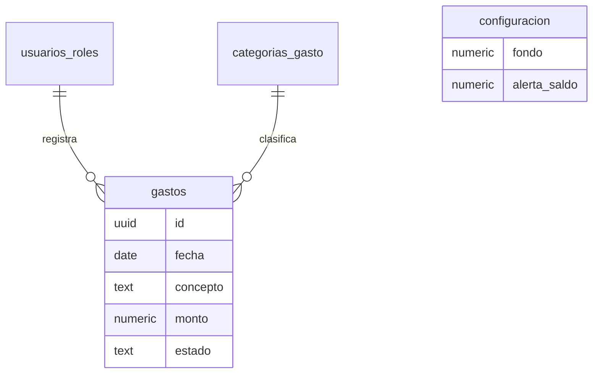

# Ejemplo completo — "Caja Chica" (1 pantalla), todo terminado

> **Nota (método v3):** este recorrido usa la numeración anterior de 22 pasos. En el método por vueltas, Caja Chica es un sistema de **una sola rebanada (R1)**: pasos 1–2 = Vuelta 0 · pasos 3–4 = condiciones e historias · pasos 5–7 = esqueleto · pasos 8–16 = R1 (R.1–R.7) · pasos 17–20 = R.8–R.11 · pasos 21–22 = siempre. El formato de cada archivo es el mismo.

> Todo es inventado para mostrar cómo se ve cada paso y qué queda guardado. Sirve también de referencia para los agentes.

---

## A. ENTENDER EL NEGOCIO

### Paso 1 · Arranque
**Dueño:** "Quiero una app para controlar la caja chica de mi restaurante."
**Agente:** crea `/docs` y empieza a investigar.

### Paso 2 · Investigación del giro
**Agente (resumen que te muestra):**
> - La caja chica es un fondo fijo para gastos menores (gas, hielo, mandados, propinas a repartidores).
> - Se maneja con "fondo fijo": se repone lo gastado contra comprobantes.
> - Problemas típicos: gastos sin comprobante, faltantes al cortar, nadie sabe quién gastó.
> - Para deducir ante el SAT se necesita comprobante; gastos sin factura no son deducibles.
> - Las apps del mercado son parte de sistemas contables grandes; casi ninguna es simple y de celular.

**Archivo:** `docs/investigacion-giro.md` (con fuentes).

### Paso 3 · Visión (una pregunta a la vez)
| P | Pregunta | Respuesta del dueño |
|---|---|---|
| P-001 | ¿Solo para tu restaurante o lo rentarás a otros? A) Solo mío B) Rentarlo | **A) Solo mío** |
| P-002 | ¿Quién la usa? | **Yo (dueño) y el cajero** |
| P-003 | ¿Cuál es el fondo de la caja chica? | **$3,000** |
| P-004 | ¿Desde dónde la usan? A) Celular B) Computadora C) Ambos | **A) Celular** |
| P-005 | ¿Qué te duele hoy? | **No sé en qué se va el dinero ni quién lo gastó** |
| P-006 | ¿Tecnología? A) Supabase + web (Recomendado: celular, gratis al inicio) B) AppSheet | **A** |

**Archivo:** `docs/00-vision.md` → "App web para celular, un solo negocio, 2 roles (dueño, cajero), fondo fijo de $3,000; objetivo: saber en qué y quién gasta."

### Paso 4 · Catálogo de funciones
**Agente:** "Te propongo estas funciones. ¿Cuáles QUITAS o mandas para después?"
| Función | Para qué | Dueño |
|---|---|---|
| Registrar gasto | anotar cada salida | ✅ v1 |
| Foto del comprobante | evidencia | ✅ v1 |
| Saldo disponible | saber cuánto queda | ✅ v1 |
| Aviso de saldo bajo | reponer a tiempo | ✅ v1 |
| Cancelar gasto con motivo | corregir errores sin borrar | ✅ v1 |
| Reposición de fondo | registrar cuando se rellena | ⏭️ después |
| Reporte mensual en Excel | contabilidad | ⏭️ después |
| Varias cajas | sucursales | ❌ no |

**Archivo:** `docs/funciones.md` · Módulo único: **Caja chica**.

---

## B. DISEÑAR LOS DATOS

### Paso 5 · Mapa de tablas
| Tabla | Para qué |
|---|---|
| `usuarios_roles` | quién es dueño y quién cajero |
| `configuracion` | fondo ($3,000) y nivel de alerta |
| `categorias_gasto` | gas, hielo, mandados… (configurable) |
| `gastos` | cada salida de dinero |

**Dueño:** "OK."

### Paso 6 · Diagrama entidad-relación

**Archivo:** `docs/diagrama-er.md`

### Paso 7 · Relaciones y reglas (como consultor)
| P | Pregunta | Respuesta |
|---|---|---|
| P-007 | ¿Un gasto puede tener varios comprobantes? A) Uno (Recomendado) B) Varios | **A** |
| P-008 | ¿Un gasto se puede repartir en varias categorías? A) No, una (Recomendado) B) Sí | **A** |
| P-009 | ¿El cajero ve los gastos del dueño? A) Sí, todos B) Solo los suyos | **A** |
| P-010 | Si se equivocan, ¿se edita o se cancela? A) Editar el mismo día, después solo cancelar (Recomendado) B) Siempre editar | **A** |
| P-011 | ¿Quién puede cancelar? A) Solo el dueño (Recomendado) B) Ambos | **A** |
| P-012 | ¿Regla fija o permiso configurable? | **Fija** (solo hay 2 roles) |

---

## C. POR CADA TABLA (ejemplo: GASTOS)

### Paso 8 · Campos
**Agente:** "Tabla GASTOS — campos propuestos. ¿Cuáles QUITAS? (sin marcar = se quedan todos)"
| Campo | Qué guarda | Tipo | Obligatorio |
|---|---|---|---|
| fecha | día del gasto | fecha | sí (hoy por defecto) |
| concepto | en qué se gastó | texto | sí |
| categoría | gas, hielo… | lista configurable | sí |
| monto | cuánto | dinero | sí |
| método | efectivo / transferencia | lista fija | sí |
| comprobante | foto | archivo/foto | no |
| notas | comentario | texto | no |

**Dueño:** marca *notas* (quitar) · en "Other": "agrega **quién recibió** el dinero".
**Agente:** "Entendí: 1) se quita notas 2) se agrega `recibio` (texto, opcional). ¿Correcto?" → **Sí**.

### Paso 9 · Comportamiento de campos
| P | Pregunta | Respuesta |
|---|---|---|
| P-013 | MONTO: ¿tope por gasto? A) Sin tope B) Máximo $1,000 (Recomendado) | **B** |
| P-014 | FECHA: ¿se puede registrar un gasto de días pasados? A) Hasta 3 días atrás (Recomendado) B) Cualquier fecha | **A** |
| P-015 | COMPROBANTE: ¿obligatorio arriba de cierto monto? A) Sí, desde $200 (Recomendado) B) Nunca | **A** |
| P-016 | CATEGORÍAS: ¿iniciales? | Gas, Hielo, Mandados, Limpieza, Propinas reparto, Otros |

### Paso 10 · Procesos
- **Alta:** cajero o dueño · valida monto 0.01–1,000, fecha ≤ 3 días atrás, comprobante si ≥ $200, saldo suficiente.
- **Edición:** el mismo día; cajero solo los suyos; dueño todos.
- **Baja:** nunca se borra; el dueño **cancela** con motivo obligatorio; el monto regresa al saldo.
- **Reactivación:** no existe; se registra uno nuevo.

**Qué pasa si…**
| # | Escenario | Comportamiento |
|---|---|---|
| 1 | El gasto deja el saldo negativo | Se bloquea: "Saldo insuficiente ($120 disponibles)" |
| 2 | Doble clic en Guardar | El botón se bloquea; solo se crea uno |
| 3 | Se cae el internet al guardar | Mensaje de error; no se guarda a medias; puede reintentar |
| 4 | El cajero intenta cancelar | El botón no aparece; la base de datos también lo rechaza |
| 5 | Se cancela un gasto ya cancelado | Bloqueado |
| 6 | Cambian el fondo de $3,000 a $4,000 | El saldo se recalcula; los gastos no cambian |
| 7 | Se desactiva la categoría "Hielo" | Ya no sale para nuevos; los anteriores la conservan |
| 8 | Gasto de $250 sin foto | Bloqueado: "Agrega el comprobante (desde $200)" |

### Paso 11 · Resumen de tabla
> GASTOS: 7 campos (+ técnicos), tope $1,000, hasta 3 días atrás, comprobante desde $200, se edita el mismo día, solo el dueño cancela con motivo, nunca se borra. **¿Así queda?** → **Sí**.

(Lo mismo se hace con `categorias_gasto`, `configuracion` y `usuarios_roles`.)

---

## D. CÓMO SE VE

### Paso 12 · Sistema de diseño
| P | Pregunta | Respuesta |
|---|---|---|
| P-017 | ¿Logo y colores? | Colores del restaurante: **verde olivo y crema** |
| P-018 | Estilo: A) Sobrio B) Moderno (Recomendado) C) Colorido | **B** |

| Token | Uso | Color |
|---|---|---|
| primario | botones, enlaces | `#5B6B2F` olivo |
| fondo | pantalla | `#FAF6EC` crema |
| texto | texto principal | `#1F2421` |
| éxito | guardado | `#2E7D32` |
| aviso | saldo bajo | `#B7791F` ámbar |
| error | cancelado, errores | `#C62828` |

Reglas: letra Plus Jakarta Sans 16 px · etiquetas arriba · obligatorios con * · errores en rojo debajo del campo · "Guardar" a la derecha y se bloquea al guardar · cancelar siempre en rojo con confirmación · montos en formato `$1,234.50`.
**Archivo:** `docs/sistema-diseno.md`

---

## E. EL MÓDULO

### Paso 13 · Pantallas y flujos
**Pantalla única: "Caja chica"** (celular)
```
┌──────────────────────────────┐
│ Caja chica          [👤]     │
│ ┌──────────────────────────┐ │
│ │ Disponible   $1,840.00   │ │  ← ámbar si < $500
│ │ Hoy gastado    $360.00   │ │
│ └──────────────────────────┘ │
│ [Hoy ▾] [Categoría ▾]        │
│ ─────────────────────────────│
│ 🧊 Hielo · Juan      $80.00  │
│ ⛽ Gas · Ana        $280.00 📎│
│ ✖ Mandados (cancelado) $50   │
│                              │
│        [ + Registrar gasto ] │
└──────────────────────────────┘
```
- **+ Registrar gasto** → formulario (fecha, concepto, categoría, monto, método, quién recibió, foto) → Guardar → aviso "Gasto guardado" → regresa a la lista.
- Clic en un gasto → detalle con foto; botones **Editar** (si es del día) y **Cancelar** (solo dueño, pide motivo).
- Lista vacía: "Aún no hay gastos hoy · Registrar gasto".

### Paso 14 · Reportes, avisos e integraciones
| P | Pregunta | Respuesta |
|---|---|---|
| P-019 | ¿Aviso de saldo bajo por dónde? A) En la app (Recomendado) B) Correo C) WhatsApp D) Varias | **D: app + WhatsApp al dueño** |
| P-020 | ¿Desde cuánto es saldo bajo? | **$500** |
| P-021 | ¿Si falla el WhatsApp? A) Solo queda el aviso en la app (Recomendado) B) Reintentar | **A** |
- Reporte: total por categoría del mes, en la misma pantalla (filtro "Mes").

### Paso 15 · Cierre del módulo
> Contradicciones: **0** · Confirmado por el dueño: **42 de 44 (95%)** · Pendientes aceptados: texto exacto del WhatsApp (💡 propuesto).

### Paso 16 · Aprobación
**Dueño:** `APROBADO caja-chica`

---

## F. CONSTRUIR

### Paso 17 · Base de datos (extracto de la migración)
```sql
create table categorias_gasto (
  id uuid primary key default gen_random_uuid(),
  nombre text not null unique check (length(trim(nombre)) > 0),
  es_sistema boolean not null default false,
  activo boolean not null default true,
  orden int not null default 0
);

create table gastos (
  id uuid primary key default gen_random_uuid(),
  fecha date not null default current_date,  -- "máx. 3 días atrás" se valida en trigger, no en CHECK:
                                              -- un CHECK con current_date fallaría al restaurar respaldos
  concepto text not null check (length(trim(concepto)) > 0),
  categoria_id uuid not null references categorias_gasto(id),
  monto numeric(12,2) not null check (monto > 0 and monto <= 1000),
  metodo text not null check (metodo in ('efectivo','transferencia')),
  recibio text,
  comprobante_url text,
  estado text not null default 'registrado' check (estado in ('registrado','cancelado')),
  motivo_cancelacion text,
  created_by uuid not null default auth.uid() references auth.users(id),
  created_at timestamptz not null default now(),
  cancelado_por uuid references auth.users(id),
  cancelado_at timestamptz,
  check (monto < 200 or comprobante_url is not null),
  check (estado = 'registrado' or motivo_cancelacion is not null)
);

create or replace function validar_fecha_gasto() returns trigger language plpgsql as $$
begin
  if new.fecha not between current_date - 3 and current_date then
    raise exception 'La fecha debe ser de hoy o hasta 3 días atrás';
  end if;
  return new;
end $$;
create trigger trg_gastos_fecha before insert or update of fecha on gastos
for each row execute function validar_fecha_gasto();

-- Cancelar: solo el dueño, transaccional, nunca borra
create or replace function cancelar_gasto(p_id uuid, p_motivo text)
returns void language plpgsql security definer set search_path = public as $$
begin
  if not exists (select 1 from usuarios_roles where usuario_id = auth.uid() and rol = 'dueno') then
    raise exception 'Solo el dueño puede cancelar';
  end if;
  update gastos set estado = 'cancelado', motivo_cancelacion = p_motivo,
         cancelado_por = auth.uid(), cancelado_at = now()
   where id = p_id and estado = 'registrado';
  if not found then raise exception 'El gasto no existe o ya estaba cancelado'; end if;
end $$;

alter table gastos enable row level security;
-- (políticas: leer todos los usuarios con rol; insertar con saldo suficiente; editar solo el mismo día; sin delete)

insert into categorias_gasto (nombre, es_sistema, orden) values
 ('Gas',true,1),('Hielo',true,2),('Mandados',true,3),('Limpieza',true,4),('Propinas reparto',true,5),('Otros',true,6);
```

### Paso 18 · Plan de construcción
| OT | Qué | Depende de | Listo cuando |
|---|---|---|---|
| OT-001 | Base de datos y seguridad | — | Migración corre; cajero no puede cancelar |
| OT-002 | Saldo y total del día | 001 | Muestra $3,000 − gastos registrados |
| OT-003 | Lista con filtros | 002 | Filtra por día, mes y categoría |
| OT-004 | Formulario de gasto + foto | 003 | Valida todas las reglas del paso 9 |
| OT-005 | Detalle, editar y cancelar | 004 | Editar solo el día; cancelar solo dueño con motivo |
| OT-006 | Aviso de saldo bajo (app + WhatsApp) | 002 | Saldo < $500 → banner ámbar y WhatsApp |
| OT-007 | Pruebas QA | todas | Todas ✅ |

**Dueño:** "OK."

### Paso 19 · Orden por orden (ejemplo OT-006)
**Agente:**
> Ok, para el aviso haría:
> 1. Calcular el saldo cada vez que se guarda o cancela un gasto
> 2. Mostrar un banner ámbar si baja de $500
> 3. Mandarte un WhatsApp la primera vez que cruce el límite
>
> **¿Te aviso cada vez que se registra un gasto con saldo bajo, o solo la primera vez que cruza los $500?**
> A) Solo la primera vez (Recomendado) B) Cada gasto

**Dueño:** A
**Agente:** **¿A qué número?** → "33 1234 5678"
**Agente:**
> 📋 **OT-006 · Aviso de saldo bajo**
> Hará: banner ámbar < $500 · un WhatsApp al cruzar el límite · se reinicia al reponer el fondo
> No hará: avisar al cajero
> Listo cuando: con $520 se registra un gasto de $40 → banner + un solo WhatsApp; otro gasto → sin WhatsApp
> Riesgo: BAJO
> **A) OK, ejecútala** · B) Cambiar · C) Ver completa

**Dueño:** OK → el agente programa, prueba y responde:
> Listo. Verificado: banner ✅ · WhatsApp llegó una vez ✅ · segundo gasto sin WhatsApp ✅ · si falla WhatsApp queda el banner ✅. Docs actualizados.

### Paso 20 · Pruebas (QA)
| Área | Pruebas | ✅ | ❌ |
|---|---|---|---|
| Reglas de base de datos | 9 | 9 | 0 |
| Permisos (cajero/dueño) | 5 | 5 | 0 |
| Qué pasa si | 8 | 7 | 1 |
> ❌ QPS-2: con doble clic muy rápido en celular lento se crearon 2 gastos → R-001, se corrige con una llave de operación única.

---

## G. MANTENER

### Paso 21 · Cambio pedido después
**Dueño:** "quiero que el cajero también pueda cancelar pero solo lo suyo y del mismo día"
**Agente:** "Esto cambia la decisión P-011 (solo el dueño cancela). ¿La reemplazamos? A) Sí: cajero cancela lo suyo del día; dueño todo (Recomendado) B) No" → **A** → orden OT-008 → OK → hecho y verificado.

### Paso 22 · Reauditoría (un mes después)
| Módulo | % | ✅ | 🟡 | ❓ | ⚠️ |
|---|---|---|---|---|---|
| Caja chica | 96% | 48 | 1 | 0 | 1 |
> ⚠️ R-004: se agregó la categoría "Comida personal" directo en la base de datos, sin pasar por la app. ¿Se queda?

---

## Qué quedó en `/docs` al final
```
docs/
├── 00-estado.md            Paso 22 · todo al día
├── 00-vision.md
├── investigacion-giro.md
├── funciones.md
├── 00-mapa.md
├── diagrama-er.md
├── sistema-diseno.md
├── modulos/caja-chica.md   tablas, campos, reglas, procesos, pantallas, avisos
├── preguntas.md            P-001 … P-021
├── decisiones.md           D-001 … D-030
├── plan-construccion.md    OT-001 … OT-008
├── ordenes/OT-001…OT-008.md
├── riesgos.md
└── bitacora.md
```
